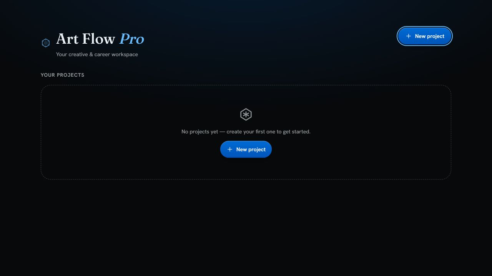
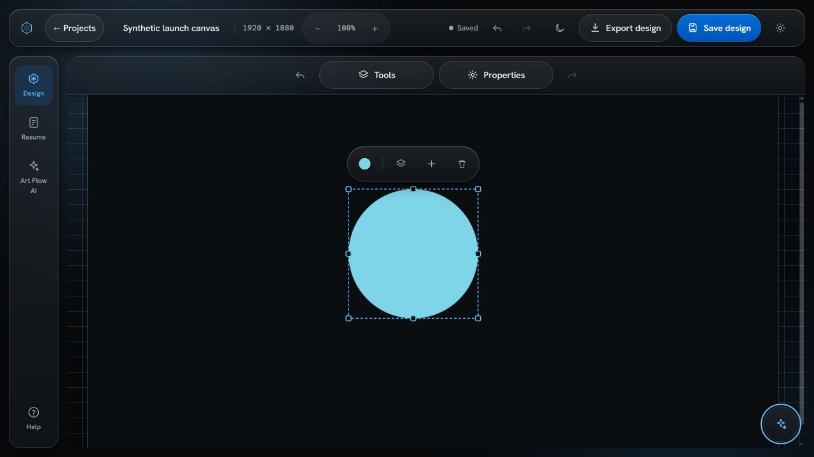
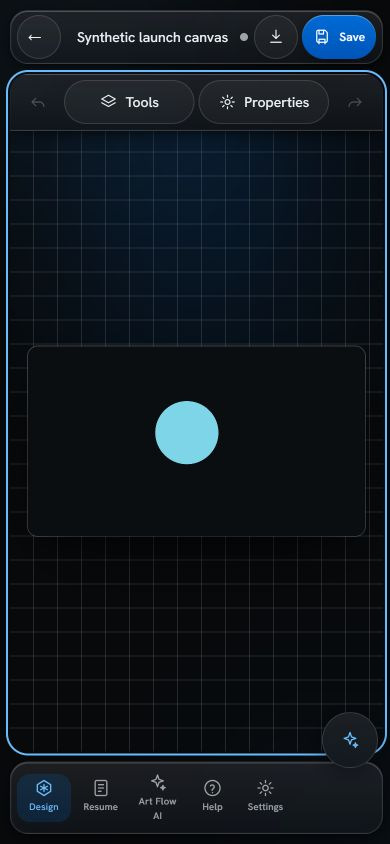
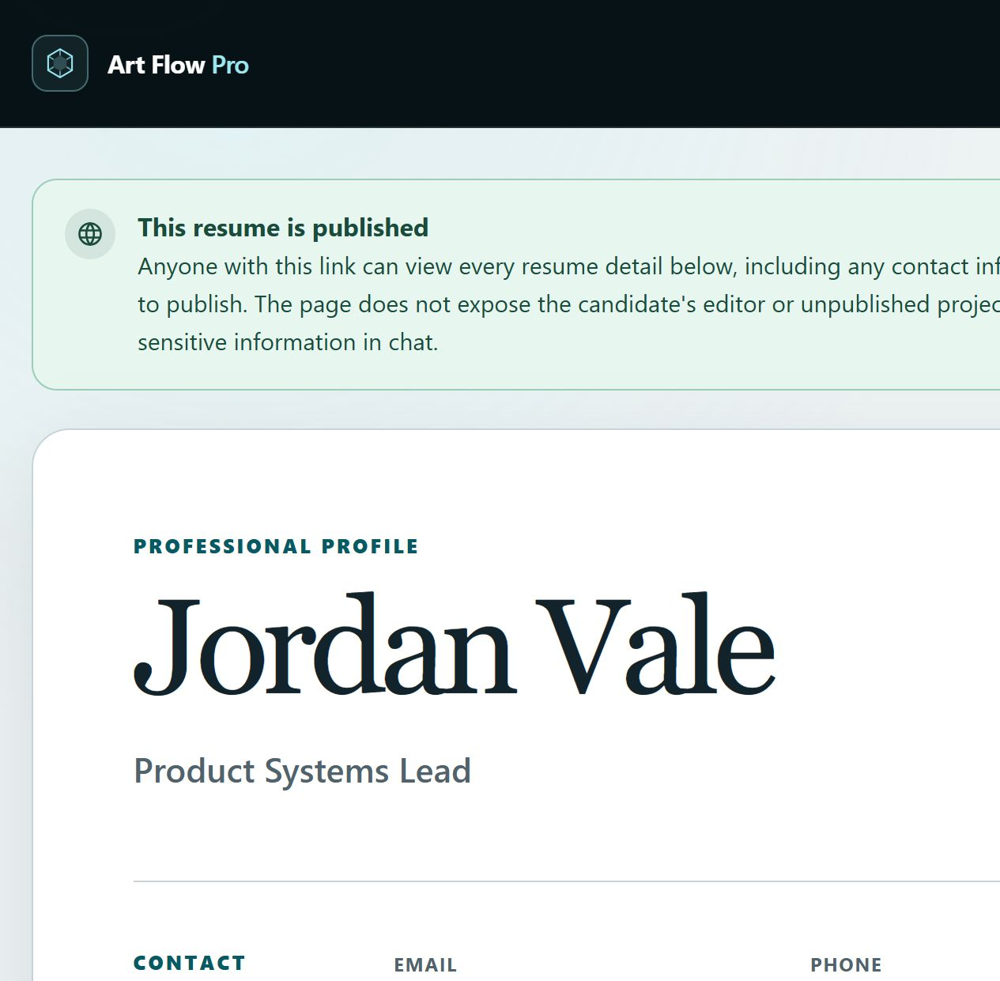
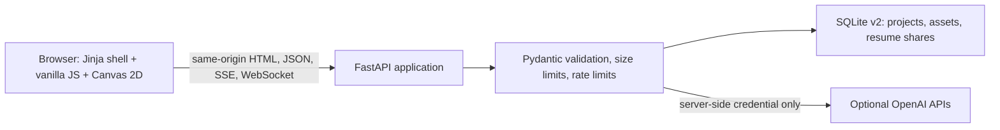

# Art Flow Pro

> **Private technical preview — not cleared for public release.** AIONEX is the
> internal maintainer label for this engineering edition. Product-name,
> contributor-rights, visual-asset, licensing, and public-release clearance are
> still pending. See [Rights and release status](docs/RIGHTS_AND_RELEASE_STATUS.md).

Art Flow Pro is a browser-native creative workspace that combines a Canvas 2D
design editor with structured resume authoring, optional OpenAI-assisted tools,
and revocable resume sharing.



## What works today

| Area | Implemented behavior |
| --- | --- |
| Design canvas | Text, rectangles, circles, generated images, selection, layers, properties, canvas presets, zoom, undo/redo, save, and browser export |
| Resume workspace | Structured fields, live A4 preview, print/PDF workflow, optional parsing and rewriting assistance |
| Project storage | Workspace-scoped design and resume projects in SQLite |
| Image assets | Validated generated images stored at stable, workspace-scoped URLs |
| Resume sharing | Opaque expiring bearer links, explicit privacy confirmation, and owner-session revocation |
| Resume assistant | Public-page questions grounded in the published resume, with bounded recent context |
| Adaptive interface | Wide desktop docks, laptop/tablet drawers, mobile bottom sheets, light/dark themes, reduced-motion and forced-color support |

The application does **not** implement user accounts, authenticated multi-
tenancy, billing, real-time collaboration, video generation, custom domains, or
cloud-scale storage. The WebSocket route is a bounded same-origin echo channel,
not a collaboration service.

## Product views

| Laptop editor | Mobile editor |
| --- | --- |
|  |  |



All screenshots come from the running application and use synthetic data. No
external AI request was made to create or validate them.

## Architecture



The intentionally compact stack keeps the product inspectable: one FastAPI
process, native browser code, and one SQLite store. The tradeoff is explicit:
the current lock, rate limiter, and storage model are single-process preview
controls, not distributed infrastructure.

Read the [architecture](docs/ARCHITECTURE.md),
[technical deep dive](docs/TECHNICAL_DEEP_DIVE.md), and
[decision records](docs/DECISIONS/README.md) for the full reasoning.

## Quick start

### Requirements

- Python 3.12 (the declared and verified runtime baseline)
- A modern browser
- An OpenAI API key only if optional AI or image features are intentionally used

### Local installation

```powershell
py -3.12 -m venv .venv
.\.venv\Scripts\Activate.ps1
python -m pip install --upgrade pip
python -m pip install --requirement requirements-lock.txt
Copy-Item .env.example .env
python -m uvicorn app:app --host 127.0.0.1 --port 8000
```

Open `http://127.0.0.1:8000`. The editor, project storage, resume preview, print,
and resume sharing work without a provider key. Leave `OPENAI_API_KEY` blank to
guarantee that optional provider routes return a controlled configuration error.

Keep the preview bound to `127.0.0.1`. Do not expose it directly to the internet.

### Docker preview

```powershell
docker build -t art-flow-pro:private-preview .
docker volume create art-flow-pro-data
docker run --rm -p 127.0.0.1:8000:8000 `
  -v art-flow-pro-data:/data `
  art-flow-pro:private-preview
```

The image runs as a non-root user and stores SQLite data in `/data`. Optional
provider configuration should be supplied through a reviewed secret mechanism,
not baked into the image or passed on a shared command line.

## Configuration

The safe template is [.env.example](.env.example). Important groups are:

- runtime: `APP_ENV`, `HOST`, `PORT`, `RELOAD`;
- optional provider: `OPENAI_API_KEY`, text/image endpoint and model settings;
- storage and sharing: `RESUME_DB`, `RESUME_TTL_DAYS`;
- network: `PROXY_URL` (`direct`, HTTP(S), or SOCKS); and
- boundaries: request, asset, AI, image, and WebSocket limits.

System `HTTP_PROXY` and `HTTPS_PROXY` are intentionally ignored because the
HTTP clients use `trust_env=False`. In production mode, provider endpoints must
use HTTPS.

Never commit `.env`, SQLite files, caches, or generated assets. The repository
[ignore rules](.gitignore) exclude them.

## Verification

Install the development toolchain, then run:

```powershell
python -m pip install --requirement requirements-dev.txt
$env:PYTEST_DISABLE_PLUGIN_AUTOLOAD = "1"
python -m ruff check app.py tests
python -m ruff format --check app.py tests
python -m mypy --no-incremental app.py tests
node --check static/script.js
python -m compileall -q app.py tests
python -m coverage run --branch -m pytest -q -p no:cacheprovider
python -m coverage report --show-missing --fail-under=58
python -m bandit --recursive app.py --severity-level medium --confidence-level medium
python -m pip_audit --requirement requirements-lock.txt --no-deps --disable-pip `
  --vulnerability-service osv --progress-spinner off
```

The current verification baseline is 14 passing tests, 63.0% executable-line
coverage, and 58.1% branch-aware combined coverage. Ruff lint, Ruff format,
MyPy, Python compilation, browser JavaScript syntax, Bandit medium/high checks,
and the resolver-free OSV audit pass. This is targeted regression evidence, not
a penetration test or production certification.

## Security and privacy model

- A random HttpOnly workspace cookie scopes projects, generated assets, and
  resume revocation. It is isolation, **not authentication**.
- Request bodies and model fields are bounded. Text/image/WS routes use
  process-local rate controls.
- API and resume responses are `no-store` and receive CSP, frame, MIME,
  referrer, permissions, and conditional HSTS headers.
- Provider credentials stay server-side. Ambiguous image failures are never
  retried; streamed text is not retried after output begins.
- Published resumes are bearer-link resources. Anyone with the URL can view the
  included contact data until expiry or revocation.
- Resume AI tools send submitted resume content to the configured provider.
  Use synthetic or consented data and review provider terms before enabling them.

See [SECURITY.md](SECURITY.md) and the
[security model](docs/SECURITY_MODEL.md) before operating the application.

## Known operational limits

- No real identity, authorization roles, CSRF design for authenticated users,
  or account recovery.
- Rate limits and locks are memory-local; multiple workers do not coordinate.
- SQLite WAL on a consumer sync folder is unsuitable for production.
- No storage encryption, workspace quota, asset garbage collection, automated
  backup/restore, audit log, or deletion-from-backup guarantee.
- Resume tokens may leak if copied, logged, or forwarded.
- Google Fonts is an external network dependency; CSP still permits inline
  styles required by the current templates.
- Optional provider use may incur cost and remains subject to external quotas
  and data-processing terms.

The [roadmap](ROADMAP.md) separates public-release gates from later product work.

## Engineering highlights

- [Workspace boundary ADR](docs/DECISIONS/0002-anonymous-workspace-boundary.md) —
  preserves an account-free local workflow while preventing global project IDOR.
- [Assets and expiring shares ADR](docs/DECISIONS/0003-sqlite-assets-and-expiring-shares.md) —
  replaces transient blob URLs and unrevocable resume pages with stable,
  owner-scoped lifecycle controls.
- [Technical deep dive](docs/TECHNICAL_DEEP_DIVE.md) — request boundaries,
  provider failure semantics, storage migration, and frontend state integrity.
- [User flows](docs/USER_FLOWS.md) — expected behavior and failure handling for
  design, resume, publication, and revocation journeys.
- [Case study](docs/CASE_STUDY.md) — evidence-based transformation narrative
  without invented users, metrics, or commercial outcomes.

## Documentation map

- [Demo script](docs/DEMO_SCRIPT.md)
- [Private v0.1.1 release notes](docs/RELEASE_NOTES_v0.1.1.md)
- [Private v0.1.0 release notes](docs/RELEASE_NOTES_v0.1.0.md)
- [Changelog](CHANGELOG.md)
- [Contributing](CONTRIBUTING.md)
- [Support](SUPPORT.md)
- [Third-party notices](THIRD_PARTY_NOTICES.md)
- [Hypothetical client adaptations](docs/CLIENT_ADAPTATION_IDEAS.md)

## Rights, naming, and license status

The supplied folder had no Git history, prior license, contributor record,
rights assignment, or competition evidence. That absence does not establish
exclusive ownership. Separately, active software businesses were found using
both “ArtFlow Pro” and “Aionex.” These findings require provenance work and a
qualified naming review before public or commercial promotion.

Accordingly:

- this repository must remain private;
- no open-source license is granted;
- no exclusive AIONEX copyright claim is made; and
- these pre-release tags are private engineering/provenance checkpoints only.

See [LICENSE](LICENSE), [NOTICE.md](NOTICE.md), and
[Rights and release status](docs/RIGHTS_AND_RELEASE_STATUS.md). Third-party
components retain their own licenses. No affiliation with similarly named
products or businesses is claimed.

---

Maintained for private review under the internal AIONEX project label.
