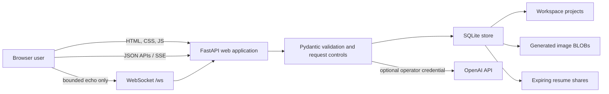

# Art Flow Pro architecture

> **Release status:** private technical preview maintained under the internal
> AIONEX project label. Product-name, ownership, licensing, and public-release
> clearance are pending. This document does not describe a public or
> production-approved service.

## System boundary

Art Flow Pro is a single-process web application for two related workflows:
a browser-based graphic canvas and a structured resume editor with an optional
shareable resume page. The current implementation deliberately preserves a
small native stack: FastAPI and Jinja on the server, vanilla JavaScript and the
Canvas 2D API in the browser, and SQLite for local persistence.

The browser and server share one origin. There is no account system, OAuth
provider, tenant administration, billing layer, queue, object store, or
distributed cache. `/ws` validates origin, message size, and rate, then echoes
messages; it is not a collaboration channel.

## Runtime components

### Browser application

`templates/index.html` provides the server-rendered application shell.
`static/script.js` owns application state and interaction logic, including:

- project dashboard loading, error, empty, and retry states;
- design-canvas objects (`text`, `rect`, `circle`, and `image`), selection,
  layers, properties, zoom, undo, redo, and export;
- explicit project save state (`saved`, `unsaved`, `saving`, or `save failed`);
- a structured resume form, live preview, local print/PDF path, and optional AI
  editing tools;
- a streamed assistant that can return a constrained `afp-actions` block for
  client-side canvas changes; and
- responsive drawers, dialogs, keyboard controls, focus handling, reduced
  motion, and light/dark themes.

Canvas history is browser memory only. A project becomes durable when the
client sends its serialized document to the project API.

### FastAPI application

`app.py` is the composition root and currently contains configuration, request
models, provider prompts, persistence, resilience controls, middleware, and
route handlers. The server:

- validates environment configuration at startup;
- creates a random anonymous workspace cookie when one is absent;
- validates bounded JSON request models with Pydantic;
- applies request-size, security-header, cache, and process-local rate controls;
- scopes project and generated-asset operations to the workspace cookie;
- stores and renders expiring resume shares;
- proxies optional text and image requests with server-side credentials; and
- serves static assets and Jinja templates.

API documentation is available only in development mode.

### SQLite store

The `ResumeStore` adapter opens one SQLite database in WAL mode with foreign
keys, a busy timeout, and secure deletion enabled. Synchronous SQLite work runs
through `asyncio.to_thread`; a process-local lock serializes mutations on the
shared connection.

| Table | Purpose | Isolation/lifecycle |
| --- | --- | --- |
| `projects` | Design or resume project JSON | Filtered by `workspace_id` |
| `assets` | Validated generated-image bytes and MIME type | Filtered by `workspace_id` |
| `resumes` | Validated resume JSON for a share link | Opaque bearer token, expiry, owner-scoped revocation |

Schema version 2 adds workspace ownership and resume revocation metadata. On
migration, the first local workspace to list projects claims legacy rows whose
workspace is `NULL`; this preserves old local work but is not an appropriate
multi-user migration strategy.

## Principal data flows

### Project persistence

1. The browser receives or reuses the `afp_workspace` cookie.
2. The project editor serializes either canvas state or a structured resume.
3. `POST /api/projects` validates the project envelope and creates or updates a
   row only within that workspace.
4. List, fetch, and delete operations apply the same workspace predicate.

The cookie is an anonymous ownership handle, not proof of identity. Losing or
replacing it can make locally stored work unreachable through the UI.

### Text assistance

1. The browser sends bounded user/assistant messages to a relevant AI route.
2. The server adds its fixed system instruction and calls the configured
   OpenAI endpoint using an operator-supplied key.
3. Chat responses are validated and relayed as server-sent events.
4. For canvas chat, the browser separates visible prose from an optional,
   allow-listed action block and applies supported actions locally.

Streaming requests may retry only before any output is relayed. After the first
delta, a transport failure ends the stream so prose or canvas actions are not
duplicated.

### Image generation

1. The browser sends a bounded prompt and desired dimensions.
2. The server maps the aspect ratio to a provider-supported size and performs
   one provider request.
3. The response is validated, decoded, checked against the asset-size limit,
   and stored as a workspace-owned SQLite BLOB.
4. The API returns `{asset_id, url}` with a stable same-origin asset URL.

An ambiguous image-provider failure is not automatically replayed because a
second request could create another charge.

### Resume sharing

1. The owner reviews a disclosure dialog and submits a validated resume.
2. The server stores the document under a random opaque token with a configured
   expiry (30 days by default).
3. Anyone who can reach `/resume/{token}` can view that resume until expiry or
   revocation; the token is the read credential.
4. Only a browser with the creating workspace cookie can call the corresponding
   delete route to revoke it.

The share is not indexed or authenticated by the application, but it is not
private once its bearer URL is disclosed.

## Deployment shape and constraints

The supported preview shape is one application process, one writable database,
and a loopback bind unless a reviewed HTTPS reverse proxy is in front. The
process-local SQLite lock, rate limiter, and image-generation lock do not
coordinate multiple workers or replicas. Before any trusted multi-user or
internet-facing deployment, the architecture needs real identity and
authorization, a durable shared data layer, distributed limits/queues, explicit
retention and deletion controls, observability, backup/restore procedures, and
a security review. See [SECURITY_MODEL.md](SECURITY_MODEL.md) and
[RIGHTS_AND_RELEASE_STATUS.md](RIGHTS_AND_RELEASE_STATUS.md).
