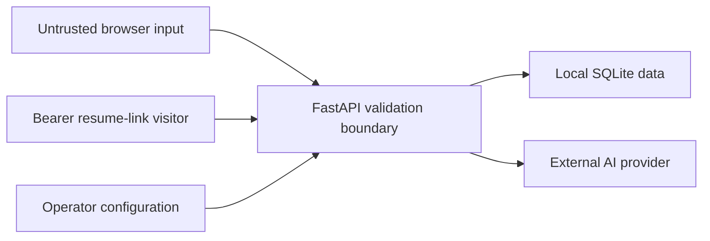

# Security model

> **Assessment boundary:** private technical preview only. AIONEX is an internal
> maintainer label. Naming, ownership, licensing, and public-release clearance
> are pending. This model records implemented controls and gaps; it is not a
> security certification or approval for internet-facing multi-tenant use.

## Assets to protect

- operator-held OpenAI API credentials and proxy configuration;
- design and resume project JSON;
- personal information contained in resumes;
- generated image bytes;
- anonymous workspace cookies and opaque resume-share tokens;
- the SQLite database, backups, logs, and local environment files; and
- provider usage quota and associated charges.

## Trust boundaries

Browser input, restored project JSON, provider output, share-link visitors, and
WebSocket messages are untrusted. The application process and its configured
database are inside the current trust boundary. The AI provider is an external
data processor whose behavior, availability, retention, and billing are not
controlled by this repository.

## Implemented controls

### Secrets and outbound requests

- AI credentials are read server-side and represented as a Pydantic
  `SecretStr`; browser responses do not intentionally expose the key.
- `.env` is local configuration and is excluded from version control; a
  placeholder `.env.example` documents supported settings.
- HTTPX ignores ambient proxy variables. Only the validated `PROXY_URL` setting
  selects an application proxy.
- Production configuration requires HTTPS provider URLs.
- AI routes fail explicitly when no key is configured.

These controls do not prove that a locally stored key was never exposed through
shell history, synchronized folders, backups, process inspection, or an earlier
unavailable repository history.

### Input and transport boundaries

- Middleware caps total HTTP request bodies; Pydantic models add field, array,
  enum, URL, and identifier bounds.
- AI, image, and WebSocket paths use process-local sliding-window limits.
- Image generation also uses a process-local single-flight lock and does not
  replay an ambiguous provider request.
- Streamed text output is validated; no retry occurs after a delta has reached
  the client.
- WebSocket connections reject a mismatched `Origin`, bound message length and
  rate, and expose echo behavior only.

Limits are keyed primarily by the direct client IP. A reverse proxy must be
configured deliberately; the application does not establish a trusted-proxy
chain. In-memory limits reset on restart and do not coordinate multiple workers.

### Browser response policy

- CSP defaults to same origin, uses a per-request script nonce, disallows
  objects and framing, and restricts connections and forms.
- `X-Content-Type-Options: nosniff`, `X-Frame-Options: DENY`,
  `Referrer-Policy: no-referrer`, and a restrictive `Permissions-Policy` are
  applied.
- HSTS is sent for HTTPS requests.
- API and resume routes use `Cache-Control: no-store` and `Pragma: no-cache`.
- Jinja's JSON escaping is used when embedding stored resume data into the
  resume page; tests cover a stored markup payload in the candidate name.

The current CSP still permits inline styles and remote Google Fonts. The server
does not force HTTP to HTTPS and does not configure a trusted-host allowlist.

### Data isolation and lifecycle

- A random HttpOnly, SameSite Lax cookie scopes project and asset CRUD and resume
  revocation. It becomes Secure in production mode or over HTTPS.
- SQL queries include both object and workspace identifiers and return not found
  across workspace boundaries.
- Resume documents are validated before storage and rendering.
- Resume links use opaque random tokens, expire after a configured interval, are
  pruned at startup and hourly, and can be revoked by the creating workspace.
- SQLite uses WAL, a busy timeout, foreign keys, and `secure_delete=ON`.

Workspace cookies are isolation handles, not authentication. Read access to a
resume is intentionally bearer-token access. SQLite files and backups are not
encrypted by the application. `secure_delete` cannot make claims about copies,
WAL history, filesystem snapshots, cloud synchronization, or storage media.

## Data disclosure map

| Action | Data leaving the browser | Destination |
| --- | --- | --- |
| Save project | Full active design/resume document | Local application and SQLite |
| Canvas chat | Conversation messages | Local server, then configured AI provider |
| Generate image | Prompt and target dimensions | Local server, then configured AI provider |
| Resume AI tool | Relevant resume text/form content | Local server, then configured AI provider |
| Resume share | Validated full resume | Local application and SQLite; readable by bearer URL |
| Shared-resume chat | Visitor messages and full stored resume as grounding | Configured AI provider |

Operators must decide whether these disclosures are lawful and appropriate,
obtain any required consent, publish an accurate privacy notice before serving
real users, and configure provider retention controls where available.

## Threats and current disposition

| Threat | Current mitigation | Residual risk / required next step |
| --- | --- | --- |
| Cross-workspace object access | High-entropy cookie and workspace predicates | Add authenticated identities, authorization tests, session rotation, and recovery |
| Stored/script injection | Typed/sanitized data, escaped template JSON, CSP | Remove inline-style allowance where feasible; expand browser security tests |
| Credential disclosure | Server-side env loading and ignore rules | Use a secret manager, rotate exposed keys, scan commits and deployment configuration |
| Provider cost abuse | IP rate limits, bounded input, image lock | Add authenticated quotas, budget alerts, distributed limits, and job accounting |
| Resume-link leakage | Opaque token, no-referrer, no-store, expiry/revoke | Add audience controls or authenticated shares; treat access logs and copied URLs as sensitive |
| Data loss/corruption | SQLite transactions and WAL | Define tested backup, restore, integrity-check, and migration procedures |
| Denial of service | Size/rate bounds and timeouts | Add reverse-proxy limits, concurrency budgets, monitoring, and distributed controls |
| Cross-site request actions | SameSite cookie and JSON APIs reduce common paths | Add explicit CSRF/Origin validation for state-changing HTTP routes |
| Host-header/routing abuse | Same-origin CSP and loopback default | Add trusted-host middleware and reviewed proxy configuration before exposure |
| Orphaned or excessive assets | Per-asset byte bound | Add per-workspace quotas, reference tracking, and garbage collection |

## Unsupported security assumptions

Do not assume that the preview provides account security, tenant isolation,
regulatory compliance, encrypted storage, confidential share links after they
are forwarded, deletion from backups, immutable audit logs, malware scanning,
content moderation, availability guarantees, or safe multi-worker operation.

## Minimum operating posture

Until the gaps above are resolved, bind to `127.0.0.1` or place the application
behind a reviewed private access layer and HTTPS reverse proxy. Use a dedicated
database outside consumer sync folders, a least-privilege provider key with
budget controls, synthetic/authorized content, and a separate browser profile.
Back up before migrations and test revocation and restore behavior. Follow
`SECURITY.md` for private vulnerability reporting and
`RIGHTS_AND_RELEASE_STATUS.md` before any public-release decision.
